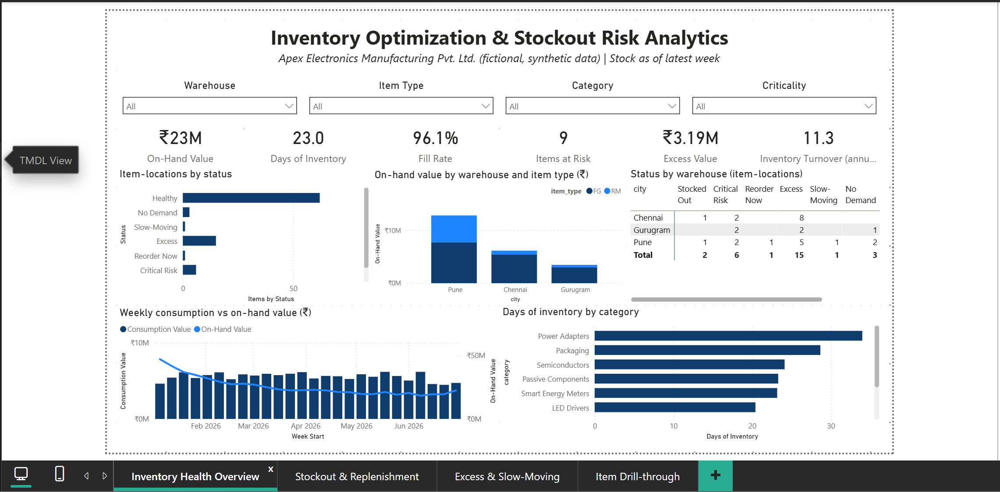
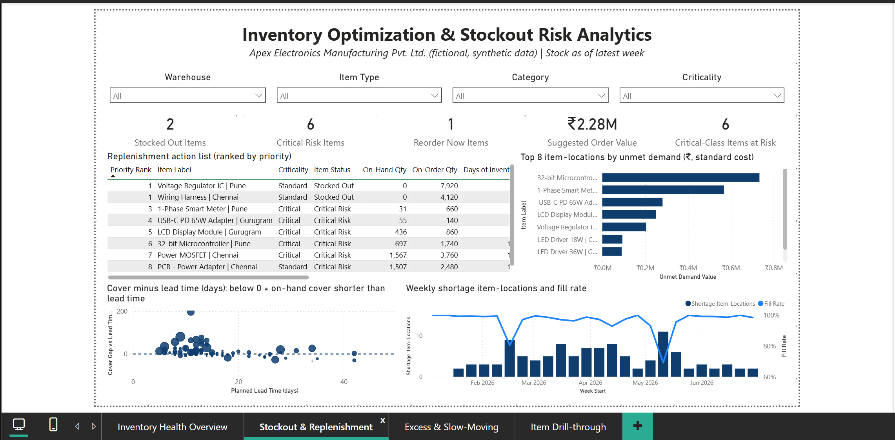
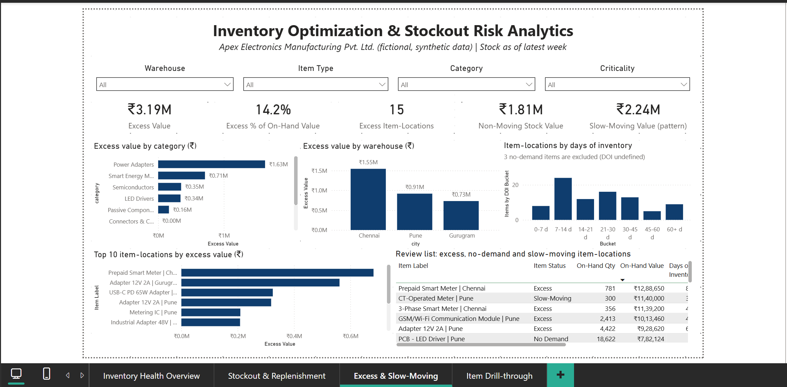
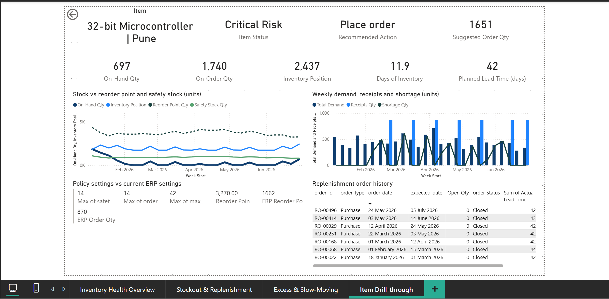

# Inventory Optimization & Stockout Risk Analytics

### Inventory Policy, Replenishment & Excess-Stock Analytics Dashboard

[](#) [](#) [](#) [](#) [](#)

---

## Project Overview

This project presents a simulated **inventory optimization analytics solution** for **Apex Electronics Manufacturing Pvt. Ltd.**, a fictional mid-sized electronics manufacturer holding raw materials and finished goods across three warehouses.

It is the second project in my Operations / Supply Chain portfolio. The first, [**MPW Performance Analytics**](https://github.com/sarthak-jaykar/MPW-Performance-Analytics), monitors production, procurement and warehouse *performance*. This project focuses on **inventory decisions**: what to replenish now, what to monitor, and where inventory is excessive.

The report applies simple, explainable inventory policies (reorder point, safety stock days, order cycle, maximum cover) to separate **observed events** (stockouts, shortages) from **calculated risk indicators** and **policy-based classifications**.

### Headline position (latest week, 29 Jun 2026)

| KPI | Result |
| --- | --- |
| On-Hand Inventory Value | **₹22.54M** (90 item-locations) |
| Days of Inventory (demand-weighted) | **23.0 days** |
| Fill Rate (26 weeks) | **96.1%** |
| Item-Locations at Risk (Stocked Out + Critical Risk + Reorder Now) | **9** (10.0%) |
| Excess Stock Value (policy-based) | **₹3.19M** (14.2% of on-hand value) |
| Non-Moving Stock Value (no demand in last 8 weeks) | **₹1.81M** |
| Suggested Order Value (action list) | **₹2.28M** |
| Inventory Turnover (consumption-based, annualized) | **11.3x** |

> **Core business question:** Which items should be replenished now, which should be monitored, and where is inventory held above what the policy supports?

> All data is **fictional and synthetic**. See [Limitations](#limitations) and [Disclaimer](#disclaimer).

---

## Business Context

Apex Electronics manufactures smart energy meters, LED drivers and power adapters. The dataset covers:

- **3** warehouses: Pune (main plant), Chennai and Gurugram (regional)
- **40** items: **24** raw materials and **16** finished goods
- **90** item-locations (item × warehouse combinations actually stocked)
- **26** weeks of weekly inventory data (5 Jan – 5 Jul 2026)
- **661** replenishment orders and **649** order receipts

Management concerns: critical-item stockout risk, excess and slow-moving stock, reorder timing and quantity, safety-stock adequacy, and capital tied up in excess inventory.

---

## Business Objectives

Management needs to:

1. Identify item-locations that are stocked out or at risk of stocking out.
2. Determine which items have reached their reorder point and what quantity to order.
3. Check whether current ERP reorder settings are consistent with demand and lead time.
4. Quantify excess and non-moving inventory under an explicit policy.
5. Compare inventory health across warehouses, categories and criticality classes.
6. Understand actual versus planned replenishment lead times.
7. Translate findings into prioritized, actionable recommendations.

---

## Key Business Questions

### Stockout risk
- Which item-locations are out of stock, and which are likely to run short?
- Is on-hand cover shorter than replenishment lead time?
- How often did demand go unmet, and where?

### Replenishment
- Which item-locations have inventory position at or below their reorder point?
- What is a defensible order quantity, given on-hand stock, on-order stock, safety stock and maximum cover?
- Where is stock already on order, so that expediting is the right action instead of a new order?

### Excess and slow-moving stock
- How much stock exceeds the maximum-cover policy?
- Which items have no recent demand at all?
- Which categories and warehouses hold the excess?

### Policy and performance
- Are the current static ERP reorder points aligned with demand and lead time?
- How do actual lead times compare with planned lead times?
- How fast does inventory turn?

---

## Data & Analytical Model

The model is centred on the **item-location** (an item stocked at a specific warehouse), with one weekly inventory fact and a compact order-and-receipt structure for replenishment.

```
dim_item ──┐
           ├─► dim_item_location ─┬─► fact_inventory_weekly ◄── dim_date
dim_warehouse ┘                   └─► fact_replenishment_orders ──► fact_order_receipts
```

| Table | Grain |
| --- | --- |
| `dim_item` | One row per item |
| `dim_warehouse` | One row per warehouse |
| `dim_item_location` | One row per item × warehouse; holds policy settings and current ERP settings |
| `fact_inventory_weekly` | One row per item-location per week |
| `fact_replenishment_orders` | One row per replenishment order (supplier purchase order for raw materials, production order for finished goods) |
| `fact_order_receipts` | One row per delivery against an order (supports partial receipts) |
| `dim_date` | Daily date table, built in Power BI |

**Reconciliation by design.** Weekly receipts equal the sum of order receipts for that item-location and week, and week-end on-order equals cumulative ordered minus cumulative received. Receipts exist in one place only, so nothing is double-counted. The validation script re-derives both independently.

Detailed field definitions are in [`documentation/Data_Dictionary.md`](documentation/Data_Dictionary.md).

---

## Key Performance Indicators

| Area | KPI | Business Logic |
| --- | --- | --- |
| Position | Inventory Position | On-Hand + On-Order (no backorders in this dataset) |
| Demand | Avg Daily Demand (ADD) | Demand over the trailing 8 weeks ÷ days (configurable window) |
| Cover | Days of Inventory | On-Hand ÷ ADD, only where ADD > 0 |
| Policy | Safety Stock | Safety-stock days × ADD (simplified days-of-cover policy) |
| Policy | Reorder Point | ADD × planned lead time + Safety Stock |
| Risk | Item Status | Rule-based: No Demand → Stocked Out → Critical Risk → Reorder Now → Excess → Slow-Moving → Healthy |
| Service | Fill Rate | Fulfilled Demand ÷ Total Demand |
| Service | Shortage Item-Weeks | Item-location weeks with unmet demand (observed) |
| Excess | Excess Stock | max(0, On-Hand − ADD × max-cover days), for items with demand |
| Excess | Non-Moving Stock Value | On-hand value of items with zero demand in the trailing window |
| Replenishment | Suggested Order Qty | max(0, Order-Up-To Level − Inventory Position), when Inventory Position ≤ Reorder Point |
| Orders | Avg Lead Time Variance | Actual first-receipt lead time − planned lead time |
| Turnover | Inventory Turnover | Annualized consumption at standard cost ÷ average inventory value |

A high risk status is an **indicator, not a confirmed stockout**. Only on-hand = 0 and weeks with recorded shortage are observed events.

Detailed DAX logic is in [`documentation/DAX_Measures.md`](documentation/DAX_Measures.md).

---

## Power BI Dashboard

The report contains four pages that move from **overview** to **action** to **diagnosis** to **item-level validation**.

### 1. Inventory Health Overview
Status distribution, inventory value by warehouse and item type, status-by-warehouse matrix, weekly consumption vs on-hand value, and days of inventory by category.



### 2. Stockout & Replenishment
Ranked action list (priority, status, cover, lead time, reorder point, suggested quantity and action), top item-locations by unmet demand, cover-versus-lead-time scatter, and weekly shortage trend.



### 3. Excess & Slow-Moving Stock
Excess value by category and warehouse, distribution of item-locations by days of inventory, top excess item-locations, and a review list of excess, no-demand and slow-moving items.



### 4. Item Drill-through
Reached by drill-through from Pages 2 and 3. Shows stock versus reorder point and safety stock over time, weekly demand, receipts and shortage, the policy and current ERP settings, and the item's order history.



---

## Key Findings

The findings below describe the **synthetic dataset**. Patterns such as under-set reorder points and late-prone lanes were seeded in the generator, so these results illustrate the method and are not real-world evidence.

1. **Two item-locations are stocked out and six more are at Critical Risk.** Voltage Regulator IC (Pune) and Wiring Harness (Chennai) have zero on-hand. For the Wiring Harness, 4,120 units are already on order, so the right action is to expedite rather than place a new order.
2. **Cover is shorter than lead time for key critical items.** The 1-Phase Smart Meter at Pune has 1.1 days of cover against a 10-day lead time; the 32-bit Microcontroller at Pune has 11.9 days against 42.
3. **Service loss is concentrated.** Shortages occurred in 111 of 2,340 item-weeks (4.7%). Two items, the 32-bit Microcontroller (Pune) and the 1-Phase Smart Meter (Pune), account for about 45% of unmet demand value (standard cost).
4. **Excess stock is ₹3.19M, or 14.2% of on-hand value.** Power Adapters account for about 51% and Chennai about 48%. One item (Adapter 12V 2A, Gurugram) holds 207 days of cover against a 42-day maximum.
5. **Another ₹4.05M sits in non-moving or slow-moving stock** (₹1.81M with no demand in the last 8 weeks and ₹2.24M matching the slow-moving pattern).
6. **Current ERP reorder points are out of line with the policy reorder point.** All 10 demand-active item-locations whose ERP reorder point is more than 25% below policy had at least one shortage; this is a seeded property of the data.

Full detail is in [`documentation/Insights_and_Strategy.md`](documentation/Insights_and_Strategy.md).

---

## Management Recommendations

All targets are **proposed management targets**, not proven results. No financial savings are claimed.

| Priority | Area | Recommended Action | Proposed Target |
| --- | --- | --- | --- |
| **P1** | Replenishment | Place orders for the 9 action items in priority order; expedite items with stock already on order | 0 stocked-out item-locations at the weekly review |
| **P1** | Service | Recalculate reorder points and safety stock for the two highest unmet-demand items | Fill rate ≥ 98% for Critical-class items |
| **P2** | Policy | Replace static ERP reorder points with `ADD × lead time + safety stock`, starting with the 10 set too low | ERP reorder point within ±25% of policy for Critical-class items |
| **P2** | Excess stock | Freeze new orders on the top excess item-locations until cover falls below maximum cover | No demand-active item-location above its maximum cover |
| **P3** | Non-moving stock | Confirm why demand stopped, stop reordering, then decide whether to hold, redistribute or dispose | Monthly review; every item has an owner |
| **P3** | Lead times | Review planned lead times by category where late deliveries are most frequent | Late orders ≤ 30% by category |

---

## Analytical Methodology

The project follows a business-first workflow:

**Business Problem → Model Design → Data Generation → Validation → Python EDA → Power BI Model → DAX → Dashboard → Insights → Recommendations**

### Python
- Seeded synthetic dataset generation
- Independent validation script (71 checks)
- Exploratory analysis using the same definitions as the report

### Power BI
- Data modeling and relationships
- DAX measures (status logic, reorder point, suggested order quantity, excess)
- What-If parameters in the model (demand window, slow-moving rule); the report uses their default values and does not expose them as slicers
- Four-page management report with drill-through

### Policy assumptions (all proposed management settings)
- Safety stock: 14 days of demand for Critical items, 7 days for Standard
- Order cycle: 14, 21 and 28 days of demand for ABC classes A, B and C
- Maximum cover: 1.5 × (safety stock days + order cycle days)
- Average daily demand: trailing 8 weeks (a What-If parameter in the model)
- Slow-moving: demand in 4 or fewer of the last 12 weeks (What-If parameters in the model)

---

## Data Validation

The validation script runs **71 checks**: columns and data types, missing values, duplicate keys, orphan records, date validity, numeric ranges, stock reconciliation, receipt and on-order reconciliation, classification consistency and dataset size. **Result: 71 passed, 0 failed.** The full output is in [`documentation/validation_report.txt`](documentation/validation_report.txt).

---

## Tools & Technologies

- **Power BI Desktop**: data modeling, DAX and dashboard development
- **Python 3.11**: dataset generation, validation and EDA
- **Pandas / NumPy**: data preparation and analysis
- **CSV**: dataset storage

---

## Repository Structure

```
Inventory-Optimization-Analytics/
│
├── README.md
│
├── data/
│   └── raw/
│       ├── dim_item.csv
│       ├── dim_warehouse.csv
│       ├── dim_item_location.csv
│       ├── fact_inventory_weekly.csv
│       ├── fact_replenishment_orders.csv
│       └── fact_order_receipts.csv
│
├── python/
│   ├── generate_data.py
│   ├── validate_data.py
│   ├── exploratory_analysis.py
│   └── requirements.txt
│
├── Powerbi/
│   └── Inventory_Optimization.pbix
│
├── documentation/
│   ├── Business_Case.md
│   ├── Data_Dictionary.md
│   ├── DAX_Measures.md
│   ├── Insights_and_Strategy.md
│   ├── validation_report.txt
│   └── eda/
│
└── Screenshots/
    ├── 01_inventory_health.png
    ├── 02_stockout_replenishment.png
    ├── 03_excess_slow_moving.png
    ├── 04_item_drillthrough.png
    └── 05_data_model.png
```

---

## How to Reproduce

### 1. Install Python dependencies

```
pip install -r python/requirements.txt
```

### 2. Generate the dataset (fixed random seed)

```
python python/generate_data.py
```

### 3. Validate the dataset

```
python python/validate_data.py
```

### 4. Run exploratory analysis

```
python python/exploratory_analysis.py
```

### 5. Open the Power BI report

Open `Powerbi/Inventory_Optimization.pbix` in Power BI Desktop. If the CSV paths do not resolve on your machine, go to **Transform data → Data source settings → Change Source** and point each file to `data/raw/`.

> Outputs depend on the NumPy and pandas versions. The validation script confirms integrity regardless of version. Exact figures in this README correspond to the committed CSV files.

---

## Documentation

- [`Business Case`](documentation/Business_Case.md): business context, scope and objectives
- [`Data Dictionary`](documentation/Data_Dictionary.md): tables, fields, generator rules and model notes
- [`DAX Measures`](documentation/DAX_Measures.md): measures used in the Power BI model
- [`Insights & Strategy`](documentation/Insights_and_Strategy.md): findings, implications and recommendations

---

## Limitations

- **Synthetic data.** Fictional company, seeded patterns, a single 26-week window.
- **Simplified safety stock.** A days-of-cover policy by item criticality; the data has no service-level target, lead-time variance model or forecast error, so no statistical safety-stock model is claimed.
- **Policy values are assumptions.** Safety-stock days, order cycle, maximum cover, the demand window and the slow-moving rule are proposed management settings.
- **Demand window sensitivity.** The 8-week average includes a seeded demand spike, so some Critical Risk flags reflect temporarily high demand.
- **Not modelled.** Minimum order quantities and pack sizes, inter-warehouse transfers, backorders, order cancellations, reservations or allocations (available stock equals on-hand).
- **Turnover** is consumption-based at standard cost, not accounting COGS.
- **No financial savings** are calculated. Excess value means capital held above the stated policy.
- The report **does not implement replenishment** or change any inventory system.

---

## Disclaimer

This is a simulated portfolio project created for learning and professional demonstration purposes. The company, operational data, scenarios and recommendations are fictional and do not represent the performance or internal operations of a real organization. The same fictional company name is used as in the MPW project to keep the portfolio consistent.

---

## Author

**Sarthak Jaykar**
B.Tech Computer Science + MBA Business Analytics

Focused on combining business understanding, data analytics and technical foundations to solve business problems through data-driven analysis.

- GitHub: <https://github.com/sarthak-jaykar>
- LinkedIn: <https://www.linkedin.com/in/sarthak-jaykar/>
